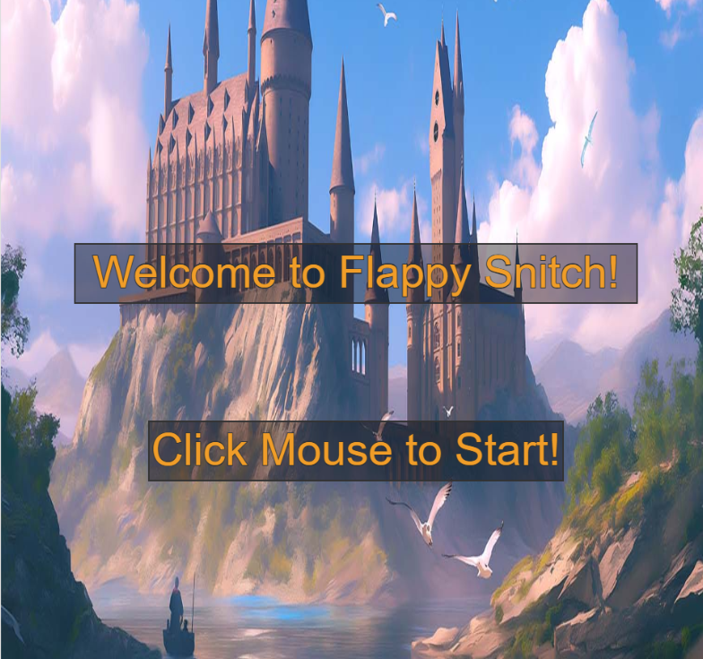
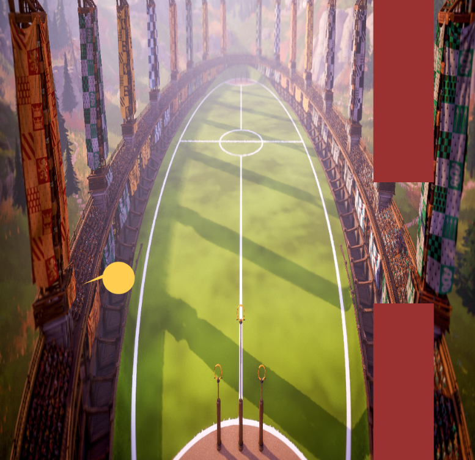

# Mini Project — Flappy Snitch: Flappy Bird Remix


---

### The Project

I built a Harry Potter version of Flappy Bird, incorporating similar game logic. I pushed past the scaffold by implementing a start screen, end screen, and features to make the game aesthetically pleasing. 

<!-- What did you build and what makes it yours? A few sentences is enough.
     What did you change, add, or push beyond the scaffold? -->

---

### Output




<!-- Drop a screenshot or GIF of your finished project.
     Save it to a readme-assets/ folder inside this project folder.
     Got more than one good screenshot? Add them. -->

<!-- [Watch Online](https://your-link-here) -->

<!-- Replace the link above with a URL to a screen recording or video of your project.
     ⚠️ Make sure the file or page is set to public before submitting. -->

---

### ✍️ Reflection

I chose to create the Flappy Bird game because my cousin used to play it with me when I was in second grade. I missed it and instantly knew I would pick this choice when I saw it as an option. The logic I used was similar to the real game: do not let the bird hit the pipes. If the pipes were hit, the game would end. The bird, or snitch in my game, is falling unless the spacebar is hit, at which point it would have a positive y velocity momentarily. The pipes’ height would be arbitrary, and the bird needs to traverse between them. When the bird hits a pipe, the “gameover” game mode is triggered, and the score is recorded. The score is the number of pipes successfully passed. The score is shown in the top left during the game, and when the game-over screen is shown, both the score and the high score are shown in the middle. After figuring out the code and successfully implementing my desired game logic, I wanted to make my game cooler. I love the Harry Potter series and wanted to make my game similar to Quidditch. Week 6 helped me learn how to load media, which helped me reach this goal. The sound effects and images made it seem like a more realistic game! Throughout the process, I encountered a few challenges. First, I mixed up “=” and “==.” I now know that “==” checks whether something is equal to something else, and “=” assigns a value to a variable. Another challenge was identifying errors. At one point, my code was messy, and it was hard to identify where the error was occurring. After tidying up my code, it became easier. Lastly, I forgot about the required videos and needed to screen-record at the end. In the future, I will make this a priority. Overall, I learned a lot about coding in this project and had a lot of fun creating something I am proud of!


---

<!-- ─────────────────────────────────────────────────────
     GOING FURTHER — want to document more? Try any of these:

     ### ✨ What I Changed
     A short list of the additions and modifications you made to the scaffold.
     - Changed the paddle to use mouse tracking instead of keyboard
     - Redesigned the visual language with a retro CRT aesthetic

     ### 🔍 Code Structure
     Briefly explain how your files are organised.
     - `sketch.js` — main game loop
     - `Ball.js` — ball class with collision logic
     - `assets/` — sprites and sounds

     ### 🧩 Something I'm Proud Of
     A snippet of code, a design decision, a moment where it clicked.
     ```js
     // your code here
     ```

     ### 🔗 References
     Anything that helped or inspired you — tutorials, artworks, tools.
     ───────────────────────────────────────────────────── -->
